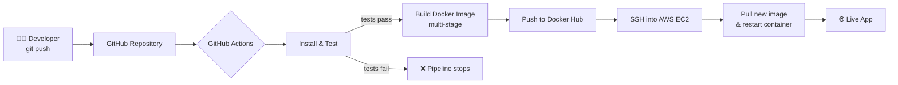

# 🐳 Docker CI/CD Project

[](https://github.com/YOUR_USERNAME/docker-cicd/actions)
[](https://hub.docker.com/r/YOUR_DOCKERHUB_USERNAME/docker-cicd)
[](https://nodejs.org/)
[](LICENSE)

A Node.js backend application that demonstrates **Docker multi-stage builds** and a fully automated **CI/CD pipeline** using **GitHub Actions**, with images published to **Docker Hub** and deployed to **AWS EC2**.

> **The big idea:** push your code to GitHub, and the pipeline tests it, packages it into a small Docker image, and deploys it to a server, with no manual steps.

---

## 📑 Table of Contents

- [Features](#-features)
- [Technology Stack](#-technology-stack)
- [Architecture](#-architecture)
- [Project Structure](#-project-structure)
- [Prerequisites](#-prerequisites)
- [Getting Started](#-getting-started)
- [Running with Docker](#-running-with-docker)
- [Understanding the Multi-Stage Build](#-understanding-the-multi-stage-build)
- [CI/CD Pipeline](#-cicd-pipeline)
- [GitHub Secrets](#-github-secrets)
- [Deploying to AWS EC2](#-deploying-to-aws-ec2)
- [Environment Variables](#-environment-variables)
- [Testing](#-testing)
- [Troubleshooting](#-troubleshooting)
- [Roadmap](#-roadmap)
- [Contributing](#-contributing)
- [License](#-license)

---

## ✨ Features

- ⚡ Lightweight **Express.js** REST backend
- 📦 **Multi-stage Docker build** for small, secure production images
- 🔁 **Automated CI/CD** with GitHub Actions (test → build → push → deploy)
- 🐋 Images published to **Docker Hub**
- ☁️ Automatic deployment to **AWS EC2**
- 🧪 Automated tests that run on every push and pull request
- 🙈 `.dockerignore` and `.gitignore` to keep images and repos clean

---

## 🛠 Technology Stack

| Layer            | Technology                    |
| ---------------- | ----------------------------- |
| Runtime          | Node.js                       |
| Framework        | Express.js                    |
| Containerization | Docker, Multi-stage Builds    |
| CI/CD            | GitHub Actions                |
| Registry         | Docker Hub                    |
| Hosting          | AWS EC2                       |

---

## 🏗 Architecture

Think of the pipeline like a **factory assembly line**: raw code goes in one end, and a packaged, running app comes out the other.



---

## 📁 Project Structure

```text
docker-cicd/
├── src/
│   └── server.js            # Express application entry point
├── tests/
│   └── app.test.js          # Automated tests
├── .github/
│   └── workflows/           # GitHub Actions pipeline definitions
├── Dockerfile               # Multi-stage Docker build
├── .dockerignore            # Files excluded from the Docker build
├── .gitignore               # Files excluded from Git
├── package.json             # Dependencies and scripts
└── package-lock.json        # Locked dependency versions
```

---

## ✅ Prerequisites

Make sure you have these installed:

| Tool    | Version | Check with         |
| ------- | ------- | ------------------ |
| Node.js | 18+     | `node --version`   |
| npm     | 9+      | `npm --version`    |
| Docker  | 20+     | `docker --version` |
| Git     | any     | `git --version`    |

You will also need accounts for **GitHub**, **Docker Hub**, and **AWS** if you want to run the full pipeline.

---

## 🚀 Getting Started

### Step 1: Clone the repository

```bash
git clone https://github.com/YOUR_USERNAME/docker-cicd.git
cd docker-cicd
```

### Step 2: Install dependencies

```bash
npm install
```

### Step 3: Start the server

```bash
npm start
```

### Step 4: Check that it works

Open your browser at **http://localhost:3000** (or the port set in your `PORT` variable).

---

## 🐋 Running with Docker

### Step 1: Build the image

```bash
docker build -t docker-cicd .
```

### Step 2: Run the container

```bash
docker run -d -p 3000:3000 --name docker-cicd-app docker-cicd
```

### Step 3: Verify it is running

```bash
docker ps
curl http://localhost:3000
```

### Useful Docker commands

```bash
docker logs docker-cicd-app          # View logs
docker stop docker-cicd-app          # Stop the container
docker rm docker-cicd-app            # Remove the container
docker images                        # List local images
docker image prune -f                # Clean up unused images
```

---

## 🧱 Understanding the Multi-Stage Build

**Analogy:** imagine building a wooden chair. You need a workshop full of saws, sanders, and sawdust to build it, but you don't carry the whole workshop to the customer's house, just the finished chair.

A multi-stage Dockerfile works the same way:

| Stage           | Purpose                                         | Ends up in final image? |
| --------------- | ----------------------------------------------- | ----------------------- |
| **Builder**     | Installs all dependencies and prepares the app  | ❌ No                   |
| **Production**  | Copies only what is needed to run the app       | ✅ Yes                  |

**Benefits:**

- 📉 Much smaller final image
- 🔒 Smaller attack surface (no build tools in production)
- 🚀 Faster pulls and deployments

Example structure (adapt to your own `Dockerfile`):

---

## 🔄 CI/CD Pipeline

The workflow files live in `.github/workflows/`. On every push to `main`, the pipeline runs these jobs in order:

| #   | Job              | What it does                                       |
| --- | ---------------- | -------------------------------------------------- |
| 1   | **Test**         | Installs dependencies and runs the test suite      |
| 2   | **Build & Push** | Builds the Docker image and pushes it to Docker Hub |
| 3   | **Deploy**       | Connects to EC2 via SSH, pulls the image, restarts the container |

## 🔐 GitHub Secrets

Go to **Repository → Settings → Secrets and variables → Actions → New repository secret** and add:

| Secret               | Description                                  |
| -------------------- | -------------------------------------------- |
| `DOCKERHUB_USERNAME` | Your Docker Hub username                     |
| `DOCKERHUB_TOKEN`    | Docker Hub access token (not your password)  |
| `EC2_HOST`           | Public IP or DNS of your EC2 instance        |
| `EC2_USER`           | SSH user (e.g. `ubuntu` or `ec2-user`)       |
| `EC2_SSH_KEY`        | Private key (`.pem`) contents for SSH access |

> ⚠️ **Never commit secrets, tokens, or `.pem` files to Git.**

---

## ☁️ Deploying to AWS EC2

### One-time server setup

**Step 1:** Launch an EC2 instance (Ubuntu recommended) and open these ports in the **Security Group**:

| Port | Purpose                    |
| ---- | -------------------------- |
| 22   | SSH (restrict to your IP)  |
| 80   | HTTP traffic               |

**Step 2:** Connect to the instance:

```bash
ssh -i your-key.pem ubuntu@YOUR_EC2_PUBLIC_IP
```

**Step 3:** Install Docker:

```bash
sudo apt update
sudo apt install -y docker.io
sudo systemctl enable --now docker
sudo usermod -aG docker $USER
```

Log out and back in so the group change takes effect.

**Step 4:** Add the secrets listed above to GitHub. From now on, every push to `main` deploys automatically. 🎉

### Verify the deployment

```bash
curl http://YOUR_EC2_PUBLIC_IP
```

---

## ⚙️ Environment Variables

| Variable   | Default       | Description              |
| ---------- | ------------- | ------------------------ |
| `PORT`     | `3000`        | Port the server listens on |
| `NODE_ENV` | `development` | Runtime environment      |

Pass variables to Docker with:

```bash
docker run -d -p 3000:3000 -e PORT=3000 -e NODE_ENV=production docker-cicd
```

---

## 🧪 Testing

Run the test suite locally:

```bash
npm test
```

Tests live in `tests/app.test.js` and run automatically in the CI pipeline before any build or deployment.

---

## 🩺 Troubleshooting

| Problem                                    | Likely cause / fix                                                     |
| ------------------------------------------ | ---------------------------------------------------------------------- |
| `port is already allocated`                | Another process uses the port. Stop it or use `-p 3001:3000`.          |
| Pipeline fails at **Docker login**         | Check `DOCKERHUB_USERNAME` and `DOCKERHUB_TOKEN` secrets.              |
| Pipeline fails at **SSH deploy**           | Verify `EC2_HOST`, `EC2_USER`, `EC2_SSH_KEY` and that port 22 is open. |
| App not reachable on EC2                   | Open port 80 in the Security Group; check `docker ps` on the server.   |
| `permission denied` running Docker on EC2  | Run `sudo usermod -aG docker $USER`, then log out and back in.         |
| Image is unexpectedly large                | Check `.dockerignore` includes `node_modules`, `.git`, and test files. |

---

## 🗺 Roadmap

- [ ] Add a `/health` endpoint and Docker `HEALTHCHECK`
- [ ] Tag images with the Git commit SHA instead of only `latest`
- [ ] Add linting (ESLint) to the pipeline
- [ ] Add Docker Compose for local development
- [ ] Add HTTPS with Nginx and Let's Encrypt
- [ ] Add vulnerability scanning (Trivy) to the pipeline

---

## 🤝 Contributing

1. Fork the repository
2. Create a feature branch: `git checkout -b feature/my-feature`
3. Commit your changes: `git commit -m "Add my feature"`
4. Push the branch: `git push origin feature/my-feature`
5. Open a Pull Request

---

## 📄 License

This project is licensed under the [MIT License](LICENSE).

---

## 👤 Author

**Muhammad Shahrukh**

- GitHub: [@YOUR_USERNAME](https://github.com/YOUR_USERNAME)

⭐ If this project helped you learn Docker and CI/CD, consider giving it a star!
